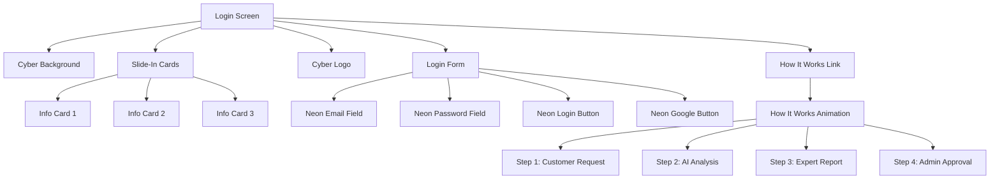

# Cyber-Themed Login Screen Implementation Plan

## Overview
Transform the current login screen into a cyber-themed interface matching the "YerimeBak Cyber Logo" aesthetic with dark theme, neon gradients, and modern animations.

## Current State Analysis
- **File**: [`lib/screens/login_screen.dart`](lib/screens/login_screen.dart:1)
- **Current Theme**: Blue gradient background (#1976D2 to dark blue)
- **Components**: Basic Card-based login form with email/password fields
- **Features**: Personel/Admin login, Google login for customers

## Implementation Plan

### 1. Cyber-Themed Background (Dark Theme with Cyber Lines)

**Objective**: Create a deep, dark background with animated cyber lines effect

**Implementation Details**:
- Dark gradient background: Deep purple (#1A0B2E) → Dark blue (#0D1B2A) → Black (#0A0E27)
- Animated cyber lines using CustomPainter:
  - Grid lines with neon glow effect
  - Scanning line animation (horizontal line moving down)
  - Circuit board pattern overlay
- Particle effects for depth

**Color Palette**:
- Background: `#0A0E27` (Deep dark blue/black)
- Primary Neon: `#00F0FF` (Turquoise/Cyan)
- Secondary Neon: `#8A2BE2` (Purple/Violet)
- Accent: `#FF00FF` (Magenta)

**Files to Create**:
- `lib/widgets/cyber/cyber_background.dart` - CustomPainter for cyber lines
- `lib/widgets/cyber/cyber_particles.dart` - Particle animation widget

### 2. Slide-In Cards Widget ("Neden YerimeBak?")

**Objective**: Add 3 horizontally scrollable info cards above login form

**Card Content**:
1. **Card 1: AI-Powered Analysis**
   - Icon: `psychology` or `smart_toy`
   - Title: "Yapay Zeka Destekli"
   - Description: "Gelişmiş AI motoru ile araç değerlemesi"

2. **Card 2: Real-Time Tracking**
   - Icon: `speed` or `timeline`
   - Title: "Anlık Takip"
   - Description: "Personel ilerlemesini canlı izle"

3. **Card 3: Secure & Fast**
   - Icon: `security` or `verified_user`
   - Title: "Güvenli & Hızlı"
   - Description: "256-bit şifreleme ile veri güvenliği"

**Animation Details**:
- Initial state: Cards slide in from right side with staggered delay
- Scrollable: Horizontal PageView for swipe navigation
- Auto-scroll: Optional auto-play every 5 seconds
- Card design: Glassmorphism with neon borders

**Files to Create**:
- `lib/widgets/cyber/slide_in_cards.dart` - Horizontal scrollable cards widget
- `lib/widgets/cyber/info_card.dart` - Individual info card component

### 3. Neon UI Elements (Turquoise & Purple Gradients)

**Objective**: Update buttons and input fields with neon gradients

**Button Styling**:
- **Personel Girişi Button**:
  - Gradient: Turquoise (#00F0FF) → Purple (#8A2BE2)
  - Glow effect: BoxShadow with neon color
  - Hover effect: Brighter glow on press

- **Google Login Button**:
  - Outline style with neon border
  - Gradient text effect
  - Hover: Fill with gradient

**Input Field Styling**:
- **Email/Password Fields**:
  - Transparent background with neon border
  - Focus state: Glowing border (cyan glow)
  - Prefix/Suffix icons: Neon colored
  - Label text: White with neon shadow
  - Placeholder text: Light gray

**Neon Glow Effect**:
```dart
BoxShadow(
  color: Color(0xFF00F0FF).withOpacity(0.5),
  blurRadius: 20,
  spreadRadius: 2,
)
```

**Files to Modify**:
- [`lib/screens/login_screen.dart`](lib/screens/login_screen.dart:1) - Update form styling
- `lib/widgets/cyber/neon_button.dart` - Reusable neon button widget
- `lib/widgets/cyber/neon_text_field.dart` - Reusable neon input field

### 4. "Nasıl Çalışır?" Animation Widget (Guest Mode/Intro)

**Objective**: Create an intro animation explaining the system before registration

**Animation Sequence** (3-5 seconds):
1. **Step 1: Customer Creates Request**
   - Animation: User icon → Request document icon
   - Text: "Müşteri talep oluşturur"

2. **Step 2: AI Analyzes & Assigns**
   - Animation: AI brain icon → Staff icon
   - Text: "AI analiz eder ve personel atar"

3. **Step 3: Expert Completes Report**
   - Animation: Staff icon → Report document
   - Text: "Personel ekspertiz raporunu tamamlar"

4. **Step 4: Admin Approves & Finances**
   - Animation: Report → Money/Check icon
   - Text: "Admin onaylar ve finansal işlemler yapılır"

**UI Elements**:
- Play/Pause button
- Progress indicator (dots or line)
- "Kayıt Ol" button at bottom
- "Misafir Olarak Devam Et" option

**Animation Tech**:
- Use `AnimatedBuilder` or `AnimationController`
- Smooth transitions between steps
- Fade in/out effects
- Icon animations (scale, rotate, slide)

**Files to Create**:
- `lib/widgets/cyber/how_it_works_animation.dart` - Main animation widget
- `lib/widgets/cyber/animation_step.dart` - Individual step widget

### 5. Cyber-Themed Logo

**Objective**: Add cyber-themed logo placeholder

**Design Options**:
1. **Animated Logo**: Pulsing neon glow effect
2. **3D Effect**: Layered text with shadow
3. **Circuit Pattern**: Logo with circuit lines around it

**Logo Elements**:
- Shield icon (current) → Cyber shield with circuit lines
- "YERIMEBAK" text with neon gradient
- Subtitle: "Güvenli Ekspertiz Sistemi" with neon glow

**Implementation**:
```dart
Container(
  decoration: BoxDecoration(
    gradient: LinearGradient(
      colors: [Color(0xFF00F0FF), Color(0xFF8A2BE2)],
    ),
    borderRadius: BorderRadius.circular(16),
    boxShadow: [
      BoxShadow(
        color: Color(0xFF00F0FF).withOpacity(0.5),
        blurRadius: 20,
      ),
    ],
  ),
  child: Icon(Icons.security, size: 64, color: Colors.white),
)
```

**Files to Create**:
- `lib/widgets/cyber/cyber_logo.dart` - Cyber logo widget

### 6. Integration & Layout Structure

**Final Layout**:
```
┌─────────────────────────────────────┐
│  Cyber Background (Full Screen)    │
│  ┌─────────────────────────────┐   │
│  │  Slide-In Cards (Top)      │   │
│  │  [Card1] [Card2] [Card3]  │   │
│  └─────────────────────────────┘   │
│  ┌─────────────────────────────┐   │
│  │  Cyber Logo                │   │
│  │  YERIMEBAK                │   │
│  └─────────────────────────────┘   │
│  ┌─────────────────────────────┐   │
│  │  Login Form (Center)       │   │
│  │  - Email (Neon Input)     │   │
│  │  - Password (Neon Input)  │   │
│  │  - Login Button (Gradient)  │   │
│  │  - Divider                │   │
│  │  - Google Button (Neon)    │   │
│  └─────────────────────────────┘   │
│  ┌─────────────────────────────┐   │
│  │  "Nasıl Çalışır?" Link   │   │
│  │  (Opens Animation Modal)   │   │
│  └─────────────────────────────┘   │
└─────────────────────────────────────┘
```

### 7. File Structure

**New Files to Create**:
```
lib/widgets/cyber/
├── cyber_background.dart          # CustomPainter for cyber lines
├── cyber_particles.dart           # Particle animation
├── cyber_logo.dart               # Cyber-themed logo
├── slide_in_cards.dart           # Horizontal scrollable cards
├── info_card.dart               # Individual info card
├── neon_button.dart             # Neon gradient button
├── neon_text_field.dart         # Neon input field
├── how_it_works_animation.dart  # Main animation widget
└── animation_step.dart          # Individual animation step
```

**Files to Modify**:
- [`lib/screens/login_screen.dart`](lib/screens/login_screen.dart:1) - Main integration

### 8. Color Constants

**Add to [`yerimebak_colors.dart`](lib/core/constants/yerimebak_colors.dart:1)**:
```dart
// Cyber Theme Colors
static const Color cyberBackground = Color(0xFF0A0E27);
static const Color cyberDarkPurple = Color(0xFF1A0B2E);
static const Color cyberDarkBlue = Color(0xFF0D1B2A);
static const Color cyberNeonTurquoise = Color(0xFF00F0FF);
static const Color cyberNeonPurple = Color(0xFF8A2BE2);
static const Color cyberNeonMagenta = Color(0xFFFF00FF);
```

### 9. Implementation Order

1. **Phase 1: Foundation** (Create constants and basic widgets)
   - Add cyber colors to [`yerimebak_colors.dart`](lib/core/constants/yerimebak_colors.dart:1)
   - Create `cyber_background.dart`
   - Create `cyber_logo.dart`

2. **Phase 2: Slide-In Cards**
   - Create `info_card.dart`
   - Create `slide_in_cards.dart`
   - Integrate into login screen

3. **Phase 3: Neon UI Elements**
   - Create `neon_button.dart`
   - Create `neon_text_field.dart`
   - Update login form with neon styling

4. **Phase 4: Animation**
   - Create `animation_step.dart`
   - Create `how_it_works_animation.dart`
   - Add "Nasıl Çalışır?" link to login screen

5. **Phase 5: Polish & Test**
   - Test all animations
   - Adjust colors and gradients
   - Verify responsive design
   - Run flutter analyze

### 10. Testing Checklist

- [ ] Cyber background renders correctly with animated lines
- [ ] Slide-in cards animate smoothly on load
- [ ] Cards are horizontally scrollable
- [ ] Neon buttons have proper gradient and glow
- [ ] Input fields show neon glow on focus
- [ ] "Nasıl Çalışır?" animation plays correctly
- [ ] All transitions are smooth (60fps)
- [ ] Dark mode works properly
- [ ] Responsive design for different screen sizes
- [ ] Flutter analyze passes with 0 issues

### 11. Mermaid Diagram - Component Flow



### 12. Performance Considerations

- Use `RepaintBoundary` for complex animations
- Cache CustomPainter objects
- Use `const` widgets where possible
- Optimize particle count for performance
- Test on low-end devices

### 13. Accessibility

- Ensure neon colors have sufficient contrast
- Add semantic labels for screen readers
- Support keyboard navigation
- Provide animation controls (pause/play)
- Respect reduced motion settings
