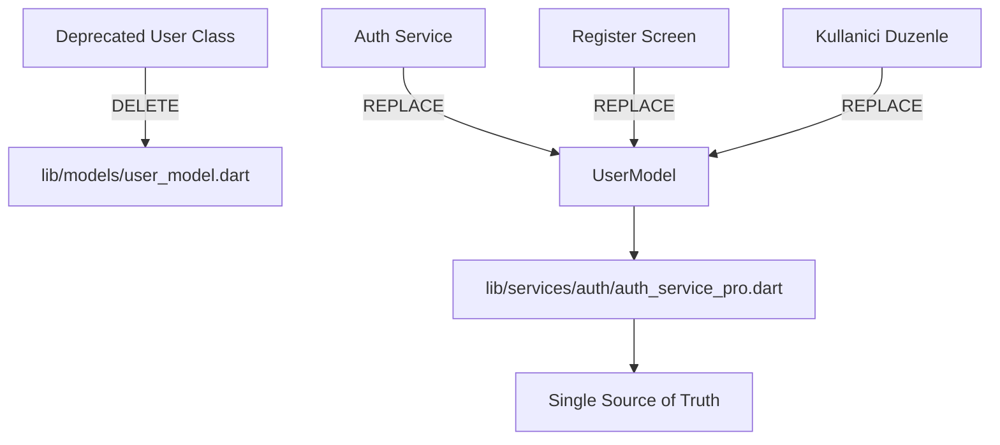
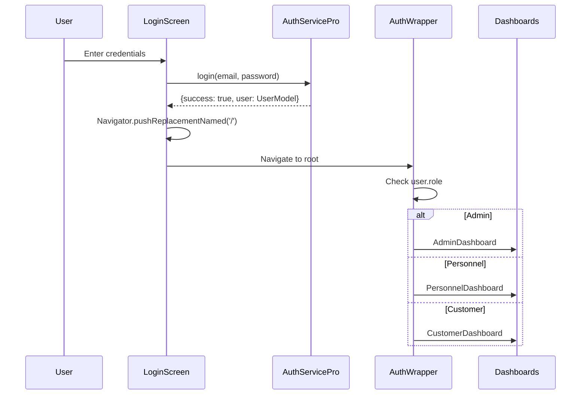
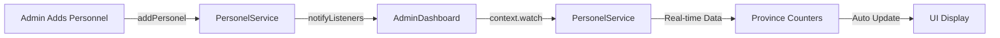
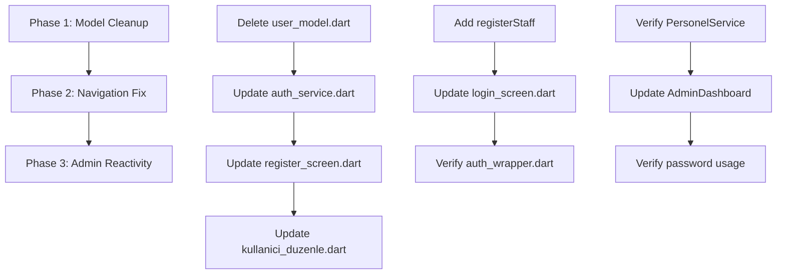

# Data Model Standardization & Navigation Automation Plan

## Executive Summary

This plan addresses three critical issues in the YerimeBak expertiz system:
1. **Model inconsistency**: Half the system uses deprecated `User` class, half uses `UserModel`
2. **Navigation deadlock**: "Hoş geldiniz" (Welcome) screen gets stuck
3. **Admin panel reactivity**: Province counters don't update when personnel are added

---

## Phase 1: Data Model and Dependency Cleanup (Global Standardization)

### Problem Analysis
- **Deprecated File**: `lib/models/user_model.dart` contains an old `User` class
- **Impact**: Flutter compiler locks due to conflicting type definitions
- **Affected Files**: 3 files import the deprecated model:
  - `lib/services/auth_service.dart`
  - `lib/screens/register_screen.dart`
  - `lib/screens/kullanici_duzenle.dart`

### Solution Architecture



### Implementation Steps

#### 1.1 Delete Deprecated Model
- **File**: `lib/models/user_model.dart`
- **Action**: Complete file deletion
- **Rationale**: File is already marked as deprecated and contains only commented code

#### 1.2 Update lib/services/auth_service.dart
**Changes Required:**
- Remove import: `import '../models/user_model.dart';`
- Add import: `import '../services/auth/auth_service_pro.dart';`
- Replace all `User` type references with `UserModel`
- Update constructor calls to match `UserModel` signature

**Key Constructor Mapping:**
```dart
// OLD (deprecated)
User(
  id: 'admin_001',
  adSoyad: 'Sistem Yöneticisi',
  email: 'admin@yerimebak.com',
  // ... other fields
)

// NEW (standardized)
UserModel(
  id: 'admin_001',
  name: 'Sistem Yöneticisi',  // adSoyad → name
  email: 'admin@yerimebak.com',
  role: UserRole.admin,  // rol → role
  ilId: 0,
  bolgeId: 0,
)
```

#### 1.3 Update lib/screens/register_screen.dart
**Changes Required:**
- Remove import: `import '../models/user_model.dart';`
- Add import: `import '../services/auth/auth_service_pro.dart';`
- Replace `User` with `UserModel` in line 27
- Update constructor parameters

#### 1.4 Update lib/screens/kullanici_duzenle.dart
**Changes Required:**
- Remove import: `import '../models/user_model.dart';`
- Add import: `import '../services/auth/auth_service_pro.dart';`
- Replace `User` with `UserModel` in lines 6, 7, 32-36, 50-59
- Update constructor parameters

---

## Phase 2: Login and Navigation Automation

### Problem Analysis
- **Issue**: Login button returns `true` but doesn't trigger navigation
- **Result**: User gets stuck on "Hoş geldiniz" screen
- **Root Cause**: Direct navigation bypasses AuthWrapper's role-based routing

### Solution Architecture



### Implementation Steps

#### 2.1 Add registerStaff Method to AuthServicePro
**Location**: `lib/services/auth/auth_service_pro.dart`

**Method Signature:**
```dart
Future<bool> registerStaff(String email, String password, String name) async {
  try {
    // 1. Create PersonelModel with provided credentials
    final personel = PersonelModel(
      id: 'staff_${DateTime.now().millisecondsSinceEpoch}',
      ad: name.split(' ')[0],
      soyad: name.split(' ').length > 1 ? name.split(' ').sublist(1).join(' ') : '',
      email: email,
      sifre: password,
      unvan: 'Saha Personeli',
      ilId: 0,  // Will be set by admin
      bolgeId: 0,  // Will be set by admin
      rol: UserRole.personel,
      aktif: true,
      kayitTarihi: DateTime.now(),
    );

    // 2. Save to PersonelService
    await _personelService.addPersonel(personel);

    // 3. Return success
    return true;
  } catch (e) {
    debugPrint('Staff registration error: $e');
    return false;
  }
}
```

**Note**: `checkSession()` method already exists at line 180 in AuthServicePro.

#### 2.2 Update Login Screen Navigation
**File**: `lib/auth/login_screen.dart`

**Current Code (Lines 57-77):**
```dart
void _navigateToDashboard(UserModel user) {
  Widget dashboard;
  switch (user.role.name) {
    case 'admin':
      dashboard = const AdminDashboard();
      break;
    case 'personnel':
      dashboard = const PersonnelDashboard();
      break;
    case 'customer':
      dashboard = const CustomerDashboard();
      break;
    default:
      dashboard = const CustomerDashboard();
  }

  Navigator.pushReplacement(
    context,
    MaterialPageRoute(builder: (_) => dashboard),
  );
}
```

**New Code:**
```dart
void _navigateToDashboard(UserModel user) {
  // Navigate to root, let AuthWrapper handle role-based routing
  Navigator.of(context).pushReplacementNamed('/');
}
```

**Rationale**: 
- Removes direct dashboard navigation
- Delegates routing to AuthWrapper
- Ensures consistent role-based access control
- Fixes the "stuck on welcome" issue

#### 2.3 Verify AuthWrapper Implementation
**File**: `lib/widgets/auth_wrapper.dart`

**Current Implementation (Lines 24-34):**
```dart
switch (user.role) {
  case UserRole.admin:
    return const AdminDashboard();
  case UserRole.personel:
    return const PersonnelDashboard();
  case UserRole.musteri:
    return const CustomerDashboard();
  default:
    return const LoginScreen();
}
```

**Status**: ✅ Already correctly implemented
- Uses `context.watch<AuthServicePro>()` for reactive updates
- Properly routes based on UserRole enum
- Handles all three role types

---

## Phase 3: Admin Panel and Region System Synchronization

### Problem Analysis
- **Issue**: Province counters don't update when personnel are added
- **Root Cause**: AdminDashboard uses static data instead of reactive service
- **Impact**: Admin doesn't see real-time personnel distribution

### Solution Architecture



### Implementation Steps

#### 3.1 Verify PersonelService Reactivity
**File**: `lib/services/personel_service.dart`

**Current Code (Lines 54-81):**
```dart
Future<void> addPersonel(PersonelModel personel) async {
  try {
    // Role-based access control
    final currentUser = AuthServicePro().currentUser;
    if (currentUser != null) {
      AccessPolicy.canAddPersonel(
        currentUser,
        personel.ilId,
        personel.bolgeId,
      );
    }

    final index = _personeller.indexWhere((p) => p.id == personel.id);
    if (index != -1) {
      _personeller[index] = personel;
    } else {
      _personeller.add(personel);
      _ilSayaclari[personel.ilId] = (_ilSayaclari[personel.ilId] ?? 0) + 1;
    }
    
    await _savePersoneller();
    notifyListeners();  // ✅ Already present at line 76
  } catch (e) {
    debugPrint('❌ Personel ekleme hatası: $e');
    rethrow;
  }
}
```

**Status**: ✅ `notifyListeners()` already exists at line 76
- Service is already reactive
- No changes needed

#### 3.2 Update AdminDashboard for Reactive Province Counters
**File**: `lib/admin/admin_dashboard.dart`

**Current Issue:**
- Dashboard uses `FutureBuilder` with `PersonelService().getPersonelViewModels()`
- Province counters are calculated from static mock data
- No reactive updates when personnel are added

**Solution:**
Use `context.watch<PersonelService>()` to subscribe to service changes

**Required Changes:**

1. **Import PersonelService** (already imported at line 12)

2. **Replace FutureBuilder with Consumer** in build method (around line 402)

**Current Code Pattern:**
```dart
return FutureBuilder<List<PersonelViewModel>>(
  future: personelService.getPersonelViewModels(),
  builder: (context, personelSnapshot) {
    final personelViewModels = personelSnapshot.data ?? [];
    // ...
  },
);
```

**New Code Pattern:**
```dart
// Watch PersonelService for reactive updates
final personelService = context.watch<PersonelService>();

// Calculate province counters from real data
final Map<int, int> provinceCounters = {};
for (final personel in personelService.personeller) {
  provinceCounters[personel.ilId] = (provinceCounters[personel.ilId] ?? 0) + 1;
}

// Use existing PersonelViewModels logic
final locationMapper = LocationMapper();
final personelViewModels = personelService.personeller.map((p) => 
  PersonelViewModel.fromModel(p, locationMapper)
).toList();
```

3. **Update Province Counter Display** in `_buildDashboard` method

**Current Mock Data (Lines 260-295):**
```dart
_musteriler.addAll([
  AdminMusteriModel(
    id: 'M001',
    adSoyad: 'Ahmet Yılmaz',
    ilId: 34,  // İstanbul
    // ...
  ),
  // ...
]);
```

**New Reactive Approach:**
```dart
// Build province statistics from real PersonelService data
final Map<int, List<PersonelModel>> provincePersonnelMap = {};
for (final personel in personelService.personeller) {
  if (!provincePersonnelMap.containsKey(personel.ilId)) {
    provincePersonnelMap[personel.ilId] = [];
  }
  provincePersonnelMap[personel.ilId]!.add(personel);
}

// Use this map to display province counters
// Each province shows: activeCount / totalCount
```

#### 3.3 Verify Password Field Usage in AuthServicePro
**File**: `lib/services/auth/auth_service_pro.dart`

**Current Code (Lines 96-108):**
```dart
// 3. Personel Kontrolü
await _personelService.loadPersoneller();
final personeller = _personelService.personeller;

try {
  var personel = personeller.firstWhere(
    (p) => (p.email == email || p.ad == email) && p.sifre == password,
  );
  user = _createUserFromPersonel(personel);
} catch (e) {
  // Personel bulunamadı
}
```

**Status**: ✅ Already correctly implemented
- Line 102: `p.sifre == password` correctly reads from PersonelModel
- Password field is properly used for authentication
- No changes needed

---

## Implementation Order & Dependencies



---

## Testing Strategy

### Phase 1 Testing
1. **Compilation Check**: Run `flutter analyze` to verify no import errors
2. **Type Safety**: Ensure all `User` references replaced with `UserModel`
3. **Runtime Check**: Verify authentication still works

### Phase 2 Testing
1. **Login Flow**: Test login for all three roles (admin, personel, musteri)
2. **Navigation**: Verify AuthWrapper routes to correct dashboard
3. **Session Persistence**: Test logout and re-login

### Phase 3 Testing
1. **Add Personnel**: Add new personnel through admin panel
2. **Counter Update**: Verify province counters update immediately
3. **Reactive UI**: Check dashboard updates without manual refresh

---

## Risk Assessment

| Risk | Impact | Mitigation |
|------|--------|------------|
| Breaking existing auth flows | High | Thorough testing of all login scenarios |
| Missing UserModel fields | Medium | Map all User fields to UserModel equivalents |
| Navigation loop | Medium | Ensure AuthWrapper handles unauthenticated state |
| Service not notifying | Low | Verify notifyListeners() in all mutation methods |

---

## Success Criteria

1. ✅ `flutter analyze` shows zero errors related to User/UserModel
2. ✅ Login successfully routes to correct dashboard based on role
3. ✅ Adding personnel updates province counters in real-time
4. ✅ No "stuck on welcome" issues
5. ✅ All authentication flows work correctly

---

## Files to Modify Summary

### Phase 1 (4 files)
1. `lib/models/user_model.dart` - DELETE
2. `lib/services/auth_service.dart` - UPDATE
3. `lib/screens/register_screen.dart` - UPDATE
4. `lib/screens/kullanici_duzenle.dart` - UPDATE

### Phase 2 (2 files)
1. `lib/services/auth/auth_service_pro.dart` - ADD method
2. `lib/auth/login_screen.dart` - UPDATE

### Phase 3 (1 file)
1. `lib/admin/admin_dashboard.dart` - UPDATE

**Total**: 7 files to modify (1 delete, 6 updates)

---

## Next Steps

Once this plan is approved, switch to **Code mode** to implement the changes in the following order:
1. Execute Phase 1 changes (model cleanup)
2. Execute Phase 2 changes (navigation automation)
3. Execute Phase 3 changes (admin panel reactivity)
4. Run `flutter analyze` to verify all fixes
5. Test all authentication and navigation flows
