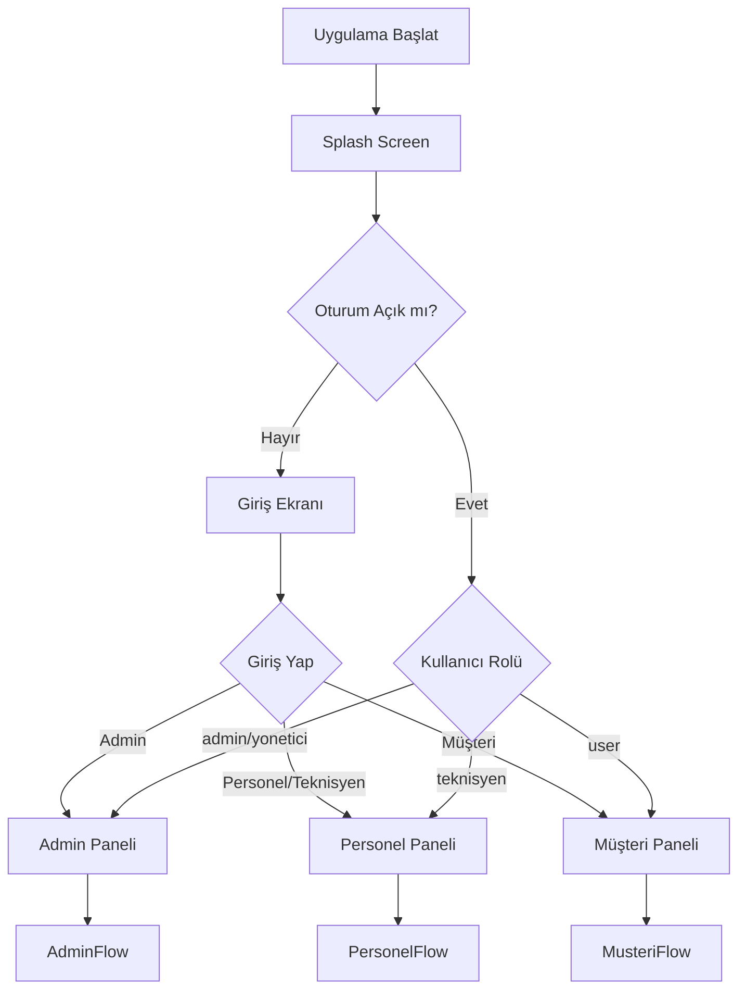
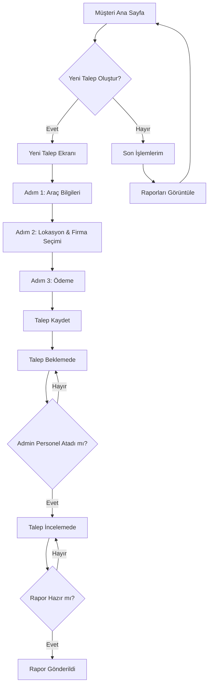
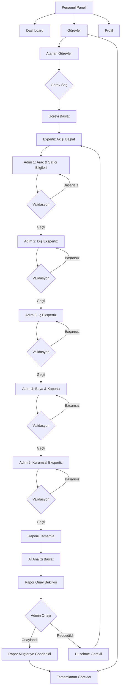
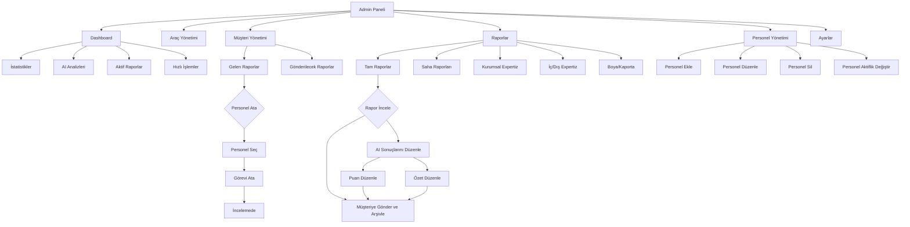
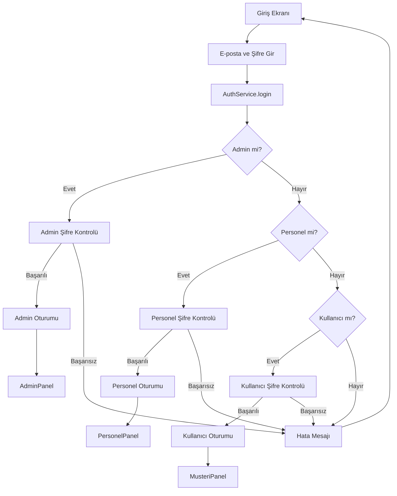
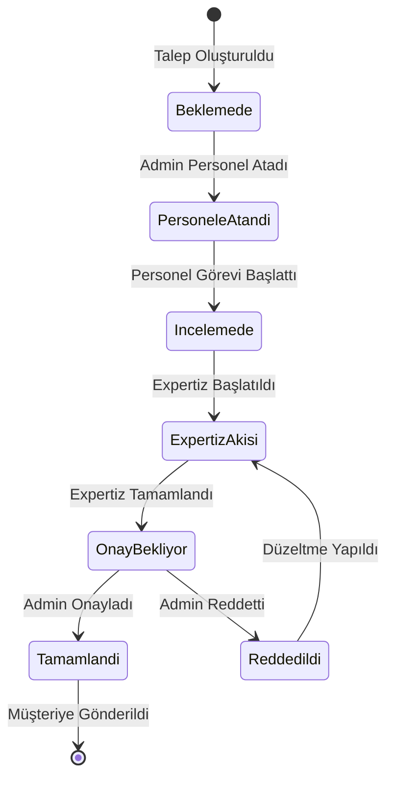
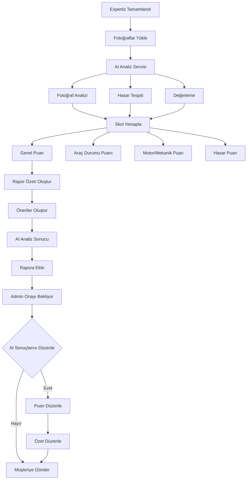
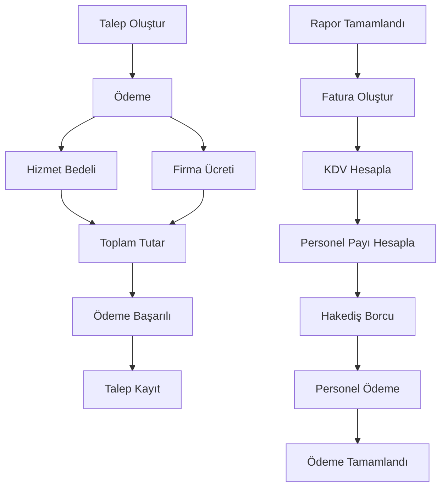

# YerimeBak Sistemleri - İş Akış Şeması

## 📊 Sistem Genel Bakış

Bu doküman, YerimeBak Sistemleri'nin tam iş akışını ve kullanıcı rolleri arasındaki etkileşimleri gösterir.

---

## 🔄 Ana İş Akışı

---

## 👤 Müşteri İş Akışı

### Müşteri Akışı Detayları

**1. Giriş ve Ana Sayfa**
- Kullanıcı giriş yapar → [`MusteriAnaSayfa`](lib/screens/musteri_ana_sayfa.dart:6)
- Hoş geldiniz mesajı ve hızlı aksiyon kartları

**2. Yeni Talep Oluşturma**
- "Yeni Ekspertiz Talebi" butonuna tıklama
- [`YeniTalepEkrani`](lib/screens/talep_olustur_ekrani.dart:3) açılır
- 3 adımlı süreç:
  - **Adım 1:** Araç bilgileri (ilan linki veya manuel giriş)
  - **Adım 2:** Şehir ve kurumsal firma seçimi
  - **Adım 3:** Ödeme (hizmet bedeli + firma ücreti)

**3. Talep Durumları**
- Beklemede → İncelemede → Hazır → Gönderildi
- Müşteri taleplerini "Son İşlemlerim" bölümünden takip eder

---

## 👷 Personel İş Akışı

### Personel Akışı Detayları

**1. Giriş ve Dashboard**
- Personel giriş yapar → [`PersonelPaneli`](lib/screens/personel_paneli.dart:49)
- Dashboard: Atanan görev sayısı, tamamlanan görev sayısı, toplam görev

**2. Görev Yönetimi**
- **Atanan Görevler:** Admin tarafından atanmış görevler
- **Tamamlanan Görevler:** Personel tarafından tamamlanan görevler

**3. Expertiz Akışı (5 Adım)**
- [`ExpertizBaslatSayfasi`](lib/screens/expertiz_akisi/expertiz_baslat_sayfasi.dart:12) üzerinden yönetilir
- **Adım 1:** [`Adim1Sayfasi`](lib/screens/expertiz_akisi/adim1_sayfasi.dart:1) - Araç ve satıcı bilgileri
- **Adım 2:** [`Adim2Sayfasi`](lib/screens/expertiz_akisi/adim2_sayfasi.dart:1) - Dış ekspertiz kontrolü
- **Adım 3:** [`Adim3Sayfasi`](lib/screens/expertiz_akisi/adim3_sayfasi.dart:1) - İç ekspertiz kontrolü
- **Adım 4:** [`Adim4Sayfasi`](lib/screens/expertiz_akisi/adim4_sayfasi.dart:1) - Boya ve kaporta kontrolü
- **Adım 5:** [`Adim5Sayfasi`](lib/screens/expertiz_akisi/adim5_sayfasi.dart:1) - Kurumsal ekspertiz

**4. AI Analiz Süreci**
- Rapor tamamlandıktan sonra AI analizi başlatılır
- AI sonuçları rapora eklenir
- Admin onayı beklenir

**5. Rapor Durumları**
- Personele Atandı → Expertiz İçinde → Onay Bekliyor → Tamamlandı/Reddedildi

---

## 👨‍💼 Admin İş Akışı

### Admin Akışı Detayları

**1. Dashboard**
- İstatistik kartları: Toplam Araç, Aktif Rapor, Personel, Müşteri
- Finansal istatistikler: Toplam Ciro, KDV, Personel Payı, Hakediş Borcu
- Son AI analizleri
- Aktif raporlar listesi
- Hızlı işlemler

**2. Araç Yönetimi**
- Araç listesi (gelen ve gönderilecek raporlar)
- Arama ve filtreleme
- Personel atama
- Rapor detayları

**3. Personel Yönetimi**
- Personel listesi (aktif/pasif)
- Personel ekleme/düzenleme/silme
- Bölge bazlı filtreleme
- [`PersonelBolgePaneli`](lib/screens/personel_bolge_sistemi.dart:1) entegrasyonu

**4. Müşteri Yönetimi**
- Gelen raporlar (müşteri talepleri)
- Gönderilecek raporlar (hazırlanmış raporlar)
- Personel atama
- Rapor gönderme

**5. Rapor Yönetimi**
- **Tam Raporlar:** 5 adımlı expertiz akışından gelen raporlar
- **Saha Raporları:** Saha personeli raporları
- **Kurumsal Expertiz:** Kurumsal müşteri raporları
- **İç/Dış Expertiz:** İç ve dış ekspertiz raporları
- **Boya/Kaporta:** Boya ve kaporta raporları

**6. AI Analiz İş Akışı**
- Rapor tamamlandıktan sonra AI analizi başlar
- AI sonuçları: Genel puan, Araç durumu, Motor/mekanik, Hasar durumu
- Admin AI sonuçlarını düzenleyebilir
- Müşteriye gönderme ve arşivleme

**7. Ayarlar**
- Tema ayarları (Aydınlık/Gece modu)
- Genel ayarlar (Bildirimler, Dil, Veri yedekleme)
- Güvenlik ayarları (Şifre değiştir, İki aşamalı doğrulama)
- Sistem bilgileri

---

## 🔐 Kimlik Doğrulama Akışı

### Kimlik Doğrulama Detayları

**1. Varsayılan Kullanıcılar**
- **Admin:** admin@yerimebak.com / 123456
- **Personel:** ahmet@yerimebak.com / 123456, fatma@yerimebak.com / 123456

**2. Oturum Yönetimi**
- [`AuthService`](lib/services/auth_service.dart:4) ile yönetilir
- Oturum bilgileri SharedPreferences'te saklanır
- Otomatik giriş desteği

**3. Rol Bazlı Yönlendirme**
- **admin/yonetici:** [`AnaSayfa`](lib/screens/ana_sayfa.dart:1) → [`AdminPaneli`](lib/screens/admin_paneli.dart:96)
- **teknisyen:** [`PersonelAnaSayfa`](lib/screens/personel_ana_sayfa.dart:1) → [`PersonelPaneli`](lib/screens/personel_paneli.dart:49)
- **user:** [`MusteriAnaSayfa`](lib/screens/musteri_ana_sayfa.dart:6)

---

## 📊 Rapor Durumları ve Geçişleri

### Rapor Durumları Açıklaması

| Durum | Açıklama | Sorumlu |
|-------|----------|---------|
| **Beklemede** | Müşteri tarafından talep oluşturuldu | Müşteri |
| **Personele Atandı** | Admin tarafından personele atandı | Admin |
| **İncelemede** | Personel görevi başlattı | Personel |
| **Expertiz İçinde** | 5 adımlı expertiz akışı devam ediyor | Personel |
| **Onay Bekliyor** | Expertiz tamamlandı, AI analizi yapıldı | Admin |
| **Tamamlandı** | Admin onayladı, müşteriye gönderildi | Admin |
| **Reddedildi** | Admin reddetti, düzeltme gerekli | Admin |

---

## 🤖 AI Analiz İş Akışı

### AI Analiz Detayları

**1. AI Analiz Bileşenleri**
- [`AIAnalizService`](lib/services/ai/ai_analiz_service.dart:1) - Ana analiz servisi
- [`AIFotografAnalizService`](lib/services/ai/ai_fotograf_analiz_service.dart:1) - Fotoğraf analizi
- [`AIOneriService`](lib/services/ai/ai_oneri_service.dart:1) - Öneri servisi
- [`AIPuanlamaService`](lib/services/ai/ai_puanlama_service.dart:1) - Puanlama servisi

**2. AI Skorları**
- **Genel Puan:** 0-100 arası
- **Araç Durumu Puanı:** Araç genel durumu
- **Motor/Mekanik Puanı:** Motor ve mekanik durum
- **Hasar Puanı:** Hasar durumu

**3. AI Önerileri**
- Kritik sorunlar
- Bakım önerileri
- Değerlendirme önerileri

**4. Admin Müdahalesi**
- AI sonuçlarını düzenleme
- Puanları manuel güncelleme
- Özetleri değiştirme

---

## 💰 Finansal İş Akışı

### Finansal Detaylar

**1. Ücretlendirme**
- **Hizmet Bedeli:** 6.500 TL (şirket hizmet bedeli)
- **Firma Ücreti:** Kurumsal firmaya göre değişir (3.000-4.500 TL)
- **Toplam Tutar:** Hizmet bedeli + Firma ücreti

**2. Finansal Hesaplamalar**
- **KDV:** %20
- **Personel Payı:** %25
- **Hakediş Borcu:** Personel ödenmemiş hak edişleri

**3. Finansal Servis**
- [`FinanceService`](lib/services/finance_service.dart:1) ile yönetilir
- Finansal özet raporları
- Ciro, KDV, personel payı, hakediş borcu hesaplamaları

---

## 📱 Ekran Geçişleri

### Müşteri Ekranları
1. **Login Screen** → MusteriAnaSayfa
2. **MusteriAnaSayfa** → YeniTalepEkrani
3. **YeniTalepEkrani** → MusteriAnaSayfa (talep oluşturulduktan sonra)

### Personel Ekranları
1. **Login Screen** → PersonelPaneli
2. **PersonelPaneli** → ExpertizBaslatSayfasi (görev başlat)
3. **ExpertizBaslatSayfasi** → Adim1-Adim5 (expertiz akışı)
4. **ExpertizBaslatSayfasi** → PersonelPaneli (görev tamamlandı)

### Admin Ekranları
1. **Login Screen** → AnaSayfa → AdminPaneli
2. **AdminPaneli** → PersonelBolgePaneli (personel yönetimi)
3. **AdminPaneli** → DetailedReportView (rapor detayı)
4. **AdminPaneli** → LoginScreen (çıkış)

---

## 🔗 Servis Entegrasyonları

### Ana Servisler
- **AuthService:** Kimlik doğrulama ve oturum yönetimi
- **PersonelService:** Personel yönetimi
- **RaporService:** Rapor yönetimi
- **TalepService:** Talep yönetimi
- **FinanceService:** Finansal işlemler
- **AI Analiz Servisleri:** AI analizi

### Veri Saklama
- **SharedPreferencesManager:** Yerel veri saklama
- Oturum bilgileri
- Kullanıcı verileri
- Personel verileri

---

## 📝 Özet

Bu YerimeBak Sistemleri, üç ana kullanıcı rolü (Müşteri, Personel, Admin) arasında koordineli bir iş akışı sağlar:

1. **Müşteri:** Araç ekspertiz talebi oluşturur ve ödeme yapar
2. **Admin:** Talebi inceleyip personele atar
3. **Personel:** 5 adımlı expertiz sürecini gerçekleştirir
4. **AI Analiz:** Raporu analiz eder ve puanlar
5. **Admin:** AI sonuçlarını inceleyip onaylar
6. **Müşteri:** Raporu alır

Sistem, Flutter tabanlı çoklu platform desteği sunar ve yerel veri saklama (SharedPreferences) kullanır.
