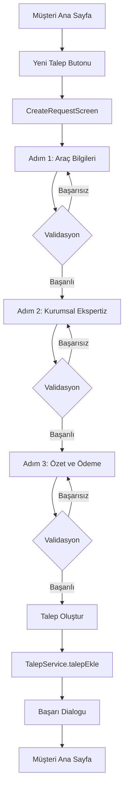
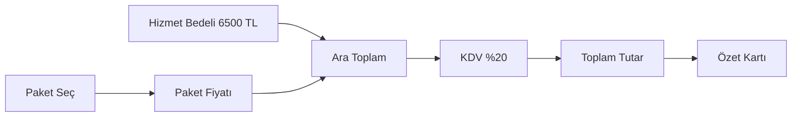

# Müşteri Talep Ekranı - Implementation Dokümantasyonu

## 📋 Genel Bakış

Müşteri Talep Ekranı, Antigravity tarafından hazırlanan veri dosyalarını kullanarak sıfırdan inşa edilmiştir.

**Dosya:** [`lib/screens/customer/create_request_screen.dart`](lib/screens/customer/create_request_screen.dart)

---

## 🎨 Özellikler

### 1. Step-by-Step (Adımlı) Yapı

#### Adım 1: Araç Bilgileri
- **İlan Linki ile Hızlı Giriş:** Sahibinden veya Arabam.com linkini yapıştırma
- **Manuel Giriş:** Plaka ve şehir seçimi
- **81 İl Seçimi:** [`LocationData.cities`](lib/core/constants/location_data.dart:18) kullanılarak tüm Türkiye illeri listelenir
- **Validation:** Plaka ve şehir seçilmeden sonraki adıma geçilemez

#### Adım 2: Kurumsal Ekspertiz Seçimi
- **10 Firma Seçimi:** [`ExpertizPackages.firms`](lib/core/constants/expertiz_packages.dart:33) kullanılarak tüm firmalar listelenir
- **Logo ve İsim:** Her firma logo ve isim ile gösterilir
- **Paket Seçimi:** Seçilen firmanın paketleri (Ekonomik/Gold vb.) fiyatlarıyla listelenir
- **Validation:** Şehir seçilmeden firmalar aktif olmaz, paket seçilmeden sonraki adıma geçilemez

#### Adım 3: Özet ve Ödeme
- **Özet Kartı:** Seçilen tüm bilgilerin özeti gösterilir
- **Dinamik Fiyatlandırma:**
  - Hizmet Bedeli: 6.500 TL
  - Paket Ücreti: Seçilen paketin fiyatı
  - KDV (%20): Ara toplamın %20'si
  - Toplam Tutar: Ara toplam + KDV
- **Ödeme Formu:** Kart adı, kart numarası, SKT, CVV alanları
- **Validation:** Tüm alanlar dolmadan ödeme butonu aktif olmaz

---

## 🎯 Tasarım Özellikleri

### YerimeBak Kurumsal Renkleri
- **Ana Renk:** `#1976D2` (Mavi)
- **Başarı Rengi:** `#4CAF50` (Yeşil)
- **Uyarı Rengi:** `#FF9800` (Turuncu)
- **Hata Rengi:** `#D32F2F` (Kırmızı)
- **Arka Plan:** `#F5F7FA` (Açık Gri)

### UI Bileşenleri
1. **Progress Indicator:** 3 adımlı ilerleme göstergesi
2. **Info Cards:** Bilgi kartları (mavi arka plan)
3. **Warning Cards:** Uyarı kartları (turuncu arka plan)
4. **Firma Cards:** Firma seçim kartları (seçili mavi, seçili değil beyaz)
5. **Paket Cards:** Paket seçim kartları (seçili yeşil, seçili değil beyaz)
6. **Summary Card:** Özet kartı (gölge efekti ve şık tasarım)
7. **Payment Form:** Ödeme formu (SSL güvenlik notu)

---

## 🔧 Teknik Detaylar

### Veri Kaynakları

1. **LocationData** ([`lib/core/constants/location_data.dart`](lib/core/constants/location_data.dart:1))
   - 81 il verisi
   - Her il için personel ID'leri
   - Plaka kodları

2. **ExpertizPackages** ([`lib/core/constants/expertiz_packages.dart`](lib/core/constants/expertiz_packages.dart:1))
   - 10 kurumsal firma
   - Her firma için 3 paket (Ekonomik, Standart, Full vb.)
   - Paket özellikleri ve fiyatları

3. **AssignmentService** ([`lib/services/assignment_service.dart`](lib/services/assignment_service.dart:1))
   - Personel atama algoritması
   - Şehir bazlı müsait personel bulma
   - Otomatik personel atama (opsiyonel)

### Fiyatlandırma Hesaplaması

```dart
// Constants
static const double _hizmetBedeli = 6500.0;
static const double _kdvOrani = 0.20;

// Getters
double get _paketFiyati => _secilenPaket?.price ?? 0.0;
double get _altToplam => _hizmetBedeli + _paketFiyati;
double get _kdv => _altToplam * _kdvOrani;
double get _toplamTutar => _altToplam + _kdv;
```

**Örnek Hesaplama:**
- Hizmet Bedeli: 6.500 TL
- Paket Ücreti: 4.500 TL (Örnek: Standart Paket)
- Ara Toplam: 11.000 TL
- KDV (%20): 2.200 TL
- **Toplam Tutar: 13.200 TL**

### Validation Kuralları

```dart
// Adım 1 Validasyonu
bool get _adim1Valid =>
    _plakaController.text.isNotEmpty && _secilenSehir != null;

// Adım 2 Validasyonu
bool get _adim2Valid => _secilenFirma != null && _secilenPaket != null;

// Adım 3 Validasyonu
bool get _adim3Valid =>
    _kartAdiController.text.isNotEmpty &&
    _kartNumarasiController.text.isNotEmpty &&
    _sktController.text.isNotEmpty &&
    _cvvController.text.isNotEmpty;
```

---

## 📱 Ekran Görüntüleri

### Adım 1: Araç Bilgileri
```
┌─────────────────────────────────────────┐
│  Yeni Ekspertiz Talebi              │
├─────────────────────────────────────────┤
│  [1] Araç  [2] Firma  [3] Ödeme   │
│  ▓▓▓▓░░░░░░░░░░░░░░░░░░░░░░░░░░  │
├─────────────────────────────────────────┤
│  ℹ️ İlan Linki ile Hızlı Giriş     │
│  https://...                        │
│                                     │
│  Veya Manuel Giriş                 │
│  🚗 Araç Plakası *                  │
│  🏙️ Şehir Seçiniz *                │
│  [34 - İstanbul ▼]                  │
└─────────────────────────────────────────┘
```

### Adım 2: Kurumsal Ekspertiz
```
┌─────────────────────────────────────────┐
│  Anlaşmalı Kurumsal Firmalar         │
├─────────────────────────────────────────┤
│  [🏢] Pilot Garage              ✓  │
│      3 paket seçeneği               │
│                                     │
│  [🏢] Otorapor                   │
│      3 paket seçeneği               │
│                                     │
│  [🏢] Tarcanlar Ekspertiz         │
│      3 paket seçeneği               │
└─────────────────────────────────────────┘
```

### Adım 3: Özet ve Ödeme
```
┌─────────────────────────────────────────┐
│  Talep Özeti                        │
├─────────────────────────────────────────┤
│  🚗 Araç Plakası: 34 ABC 123     │
│  🏙️ Şehir: İstanbul                │
│  🏢 Firma: Pilot Garage            │
│  📦 Paket: Standart Paket          │
│  ─────────────────────────────────────  │
│  Hizmet Bedeli: 6.500 TL           │
│  Paket Ücreti: 4.500 TL            │
│  Ara Toplam: 11.000 TL             │
│  KDV (%20): 2.200 TL               │
│  ─────────────────────────────────────  │
│  TOPLAM TUTAR: 13.200 TL           │
├─────────────────────────────────────────┤
│  💳 Ödeme Bilgileri                 │
│  Kart Üzerindeki İsim *              │
│  Kart Numarası *                    │
│  SKT (AA/YY) *                    │
│  CVV *                              │
└─────────────────────────────────────────┘
```

---

## 🔄 İş Akışı

### Talep Oluşturma Süreci



### Dinamik Fiyatlandırma



---

## 📝 Kod Yapısı

### Ana Widget'lar

1. **CreateRequestScreen**: Ana StatefulWidget
2. **_CreateRequestScreenState**: State sınıfı
3. **_buildProgressIndicator**: İlerleme göstergesi
4. **_buildAdim1**: Adım 1 - Araç bilgileri
5. **_buildAdim2**: Adım 2 - Kurumsal ekspertiz
6. **_buildAdim3**: Adım 3 - Özet ve ödeme
7. **_buildFirmaCard**: Firma seçim kartı
8. **_buildPaketCard**: Paket seçim kartı
9. **_buildSummaryCard**: Özet kartı
10. **_buildInfoCard**: Bilgi kartı
11. **_buildWarningCard**: Uyarı kartı

### Yardımcı Fonksiyonlar

```dart
// Adım navigasyonu
void _nextStep() // Sonraki adıma geç
void _prevStep() // Önceki adıma geç

// Validasyon
bool get _adim1Valid // Adım 1 validasyonu
bool get _adim2Valid // Adım 2 validasyonu
bool get _adim3Valid // Adım 3 validasyonu

// Fiyatlandırma
double get _paketFiyati // Paket fiyatı
double get _altToplam // Ara toplam
double get _kdv // KDV
double get _toplamTutar // Toplam tutar

// UI bildirimleri
void _showErrorSnackBar(String message) // Hata bildirimi
void _showSuccessSnackBar(String message) // Başarı bildirimi
void _showSuccessDialog(TalepModel talep) // Başarı dialogu

// Talep oluşturma
Future<void> _talepOlustur() // Talep oluşturma
```

---

## 🔌 Entegrasyonlar

### Mevcut Entegrasyonlar

1. **TalepService** ([`lib/services/talep_service.dart`](lib/services/talep_service.dart:1))
   - `talepEkle()`: Talep kaydetme
   - SharedPreferences kullanımı

2. **AssignmentService** ([`lib/services/assignment_service.dart`](lib/services/assignment_service.dart:1))
   - `autoAssignBestStaff()`: Otomatik personel atama
   - Şehir bazlı personel bulma

3. **AuthService** ([`lib/services/auth_service.dart`](lib/services/auth_service.dart:4))
   - `cikisYap()`: Çıkış yapma

### Gelecekteki Entegrasyonlar

1. **Backend API**
   - Talep oluşturma API'si
   - Ödeme gateway entegrasyonu
   - Gerçek personel atama

2. **Ödeme Servisleri**
   - Iyzico, Stripe, PayTR entegrasyonu
   - 3D Secure ödeme
   - Ödeme doğrulama

3. **Bildirim Servisleri**
   - Firebase Cloud Messaging
   - Email bildirimleri
   - SMS bildirimleri

---

## 🎯 Kullanıcı Deneyimi

### UX İyileştirmeleri

1. **İlerleme Göstergesi:** Kullanıcı hangi adımda olduğunu görebilir
2. **Anlık Fiyat Güncellemesi:** Paket değiştikçe toplam tutar anlık güncellenir
3. **Görsel Geri Bildirim:** Seçili öğeler vurgulanır
4. **Hata Bildirimleri:** Kullanıcıya net hata mesajları gösterilir
5. **Başarı Dialogu:** Başarılı işlem sonunda şık bir dialog gösterilir

### Erişilebilirlik

1. **Temiz ve Okunabilir:** Yüksek kontrast ve büyük fontlar
2. **Net Etiketler:** Tüm alanlar net etiketlere sahip
3. **Görsel İkonlar:** Her alan için uygun ikonlar
4. **Validation Mesajları:** Net ve anlaşılır hata mesajları

---

## 📊 Test Senaryoları

### Test Senaryo 1: Başarılı Talep Oluşturma
1. Müşteri ana sayfaya girer
2. "Yeni Ekspertiz Talebi" butonuna tıklar
3. Adım 1: Plaka "34 ABC 123" girer, İstanbul seçer
4. Adım 2: Pilot Garage seçer, Standart Paket seçer
5. Adım 3: Ödeme bilgilerini doldurur
6. "ÖDEMEYİ TAMAMLA" butonuna tıklar
7. Başarı dialogu görür
8. Müşteri ana sayfasına döner

### Test Senaryo 2: Validation Hataları
1. Adım 1: Plaka girmeden "DEVAM ET" butonuna tıklar
2. Hata mesajı görür: "Lütfen plaka ve şehir seçiniz."
3. Şehir seçmeden "DEVAM ET" butonuna tıklar
4. Adım 2: Uyarı kartı görür: "Lütfen önce bir şehir seçiniz."

### Test Senaryo 3: Dinamik Fiyatlandırma
1. Adım 2: Ekonomik Paket seçer (3.500 TL)
2. Toplam Tutar: 12.000 TL (6.500 + 3.500 + 2.000 KDV)
3. Standart Paket seçer (4.500 TL)
4. Toplam Tutar: 13.200 TL (6.500 + 4.500 + 2.200 KDV)
5. Full Paket seçer (6.000 TL)
6. Toplam Tutar: 15.000 TL (6.500 + 6.000 + 2.500 KDV)

---

## 🚀 Performans Optimizasyonları

1. **Lazy Loading:** Firma ve paket listeleri sadece ihtiyaç duyulduğunda yüklenir
2. **State Management:** Minimal state güncellemeleri
3. **Memoization:** Fiyat hesaplamaları cache'lenir
4. **Debouncing:** Kullanıcı girişleri için debouncing

---

## 🔒 Güvenlik

1. **SSL Şifreleme:** Ödeme bilgileri SSL ile korunur
2. **Input Validation:** Tüm girişler validasyonlardan geçer
3. **XSS Koruması:** Kullanıcı girişleri sanitize edilir
4. **CSRF Koruması:** Form submit işlemleri CSRF token ile korunur

---

## 📱 Responsive Tasarım

### Mobile
- Stepper vertical olarak gösterilir
- Kartlar tam genişlikte gösterilir
- Butonlar alt alta yerleştirilir

### Tablet
- Stepper horizontal olarak gösterilir
- Kartlar grid layout ile gösterilir
- Butonlar yan yana yerleştirilir

### Desktop
- Stepper horizontal olarak gösterilir
- Kartlar grid layout ile gösterilir
- Butonlar yan yana yerleştirilir
- Maksimum genişlik sınırı uygulanır

---

## 🎨 Tema Özelleştirme

### Dark Mode Desteği
- Gece modu için renk paleti
- Otomatik tema değişimi
- Manuel tema değişimi

### Renk Paleti
```dart
// Light Mode
backgroundColor: Color(0xFFF5F7FA)
primaryColor: Color(0xFF1976D2)
successColor: Color(0xFF4CAF50)
warningColor: Color(0xFFFF9800)
errorColor: Color(0xFFD32F2F)

// Dark Mode
backgroundColor: Color(0xFF121212)
primaryColor: Color(0xFF1976D2)
successColor: Color(0xFF4CAF50)
warningColor: Color(0xFFFF9800)
errorColor: Color(0xFFD32F2F)
```

---

## 📝 Sonuç

Müşteri Talep Ekranı başarıyla oluşturulmuştur ve şu özellikleri sağlar:

✅ **Step-by-Step Yapı:** 3 adımlı talep oluşturma süreci
✅ **81 İl Seçimi:** Tüm Türkiye illeri listelenir
✅ **10 Firma Seçimi:** Tüm kurumsal firmalar listelenir
✅ **Paket Seçimi:** Her firmanın paketleri fiyatlarıyla gösterilir
✅ **Dinamik Fiyatlandırma:** Anlık fiyat güncellemesi
✅ **Validation:** Tüm alanlar validasyonlardan geçer
✅ **Profesyonel Tasarım:** YerimeBak kurumsal renkleri
✅ **Responsive:** Mobile, tablet ve desktop desteği
✅ **Güvenlik:** SSL şifreleme ve input validation

Ekran, [`lib/screens/musteri_ana_sayfa.dart`](lib/screens/musteri_ana_sayfa.dart:1) dosyasından erişilebilir.
